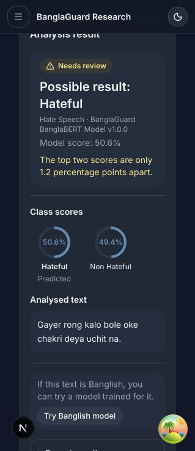
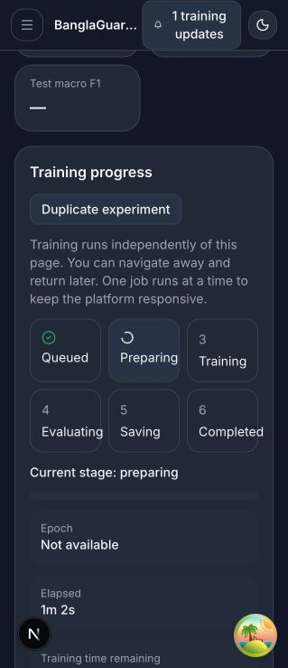
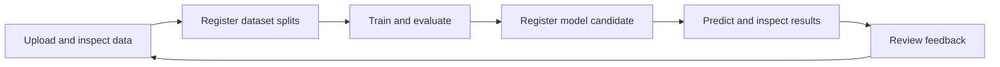

# BanglaGuard

BanglaGuard is a research workspace for **Bangla and Banglish hate speech detection and sentiment analysis**. It connects text prediction and model explanations to dataset preparation, reproducible training, error analysis, feedback, and model promotion.

The project helps researchers answer more than “what label did the model return?” It also shows which model ran, how close the class scores were, what text fragments supported the prediction, and where a candidate makes mistakes before it becomes the default.

[Screenshots](#screenshots) · [Features](#features) · [How it works](#how-it-works) · [Run locally](#run-locally) · [Developer guide](docs/DEVELOPER_GUIDE.md)

## What problem does BanglaGuard solve?

A model trained on Bengali-script text may behave differently when users write Bengali in Latin script, mix it with English, or use informal spellings. A second difficulty is that a negative comment, a personal insult, and an identity-based attack are not interchangeable. BanglaGuard gives researchers a way to test those distinctions with their own labeled datasets and compare how different models behave on the same examples.

A typical user enters a sentence, selects **Hate speech**, **Sentiment**, or a Banglish shortcut, and sees a predicted label and class scores. A researcher can choose a candidate model, inspect the evidence for a result, or go back to the training experiment to see how the model performed. The same interface lets reviewers collect corrections for the next dataset version.

## Screenshots

| Prediction and review | Background training |
| --- | --- |
|  |  |
| The top two scores differ by just 1.2 percentage points. The page explains the review flag and offers to try a Banglish model on the same text. | A BanglaBERT job is preparing. Progress is tracked independently of the browser, so researchers can leave the experiment page and return later. |

## Features

| Workspace | What you can do |
| --- | --- |
| **Prediction** | Analyse Bangla, Romanized Bangla (Banglish), or mixed text; select a task and compatible model; inspect class scores, supporting tokens, and review warnings. |
| **Datasets** | Import labeled CSV files or predefined splits, map text and labels, inspect class balance and duplicates, and register a reproducible dataset version. |
| **Experiments** | Train TF-IDF/logistic regression or BanglaBERT in the background. Track progress, review held-out scores, and inspect confusion matrices and individual errors. |
| **Model registry** | Register trained models as candidates, test them without changing the default, and review evidence before promotion or rollback. |
| **Research tools** | Compare model predictions, analyse CSV batches, and save regression cases. |
| **Feedback and administration** | Report wrong predictions, review and export corrected examples, and manage roles, platform policy, and audit records. |

Hate speech and sentiment are separate tasks. The trained model determines which labels are available: a binary hate speech model returns hate/non-hate, while a three-class model trained with an offensive label can distinguish it separately.

## How it works



| Layer | Technology and responsibility |
| --- | --- |
| Browser | Next.js, React, TypeScript, and Tailwind provide the prediction and research workspaces. |
| API | FastAPI validates requests and permissions, selects models, and coordinates dataset, training, and feedback operations. |
| Training and inference | scikit-learn handles classical baselines. PyTorch and Hugging Face Transformers handle BanglaBERT. A separate worker runs one training job at a time. |
| Persistence | PostgreSQL stores application records; Redis supports runtime services; a local SQLite queue tracks training jobs. The filesystem stores uploads, metrics, and model artifacts. |

See the [architecture diagram and repository map](docs/DEVELOPER_GUIDE.md#architecture), [training workflow](docs/DEVELOPER_GUIDE.md#research-workflow), and [prediction and feedback sequence](docs/DEVELOPER_GUIDE.md#prediction-and-feedback-flow).

## End-to-end research walkthrough

1. **Prepare the dataset.** Upload a labeled CSV with columns such as `text,label`, or import existing train, validation, and test files. Map the labels, inspect their counts, and review duplicates and conflicting annotations before registering a version. A dataset belongs to one task.
2. **Set up the experiment.** Choose the dataset version, model family, and settings. A character-level TF-IDF baseline is a fast starting point for spelling variations. BanglaBERT fine-tuning learns a classifier from a pretrained checkpoint. Run the readiness checks before starting.
3. **Train and inspect errors.** BanglaGuard queues the job and records its settings, progress, and outputs. Use validation to choose settings or checkpoints, then use the held-out test split to compare performance. The error explorer shows which labels were confused and lets you inspect the underlying examples.
4. **Register and try the candidate.** Register the completed model from the experiment. Researchers and admins can select a compatible candidate on the Prediction page without changing the default. The app records the model version used in each result.
5. **Review and iterate.** Inspect class scores, open technical details for word contributions, and report an incorrect result. Feedback can be reviewed and exported for a future dataset version. A correction does not immediately change the trained model.

### What the results mean

In an example Banglish hate speech experiment, character TF-IDF reached **0.703 macro F1** and BanglaBERT reached **0.742** on the same **999 held-out comments**. BanglaBERT still missed **155 of 567** comments labeled hateful and falsely flagged **101 of 432** comments labeled non-hateful. The scores describe that dataset, not every Bangla or Banglish input.

A separate three-class BanglaBERT experiment learned `hate`, `offensive`, and `non_hate` from provisional dataset labels. It reached **0.905 macro F1** on **226 held-out comments** from that dataset, but missed all four ordinary insults in a small, hand-written challenge set. These two experiments used different datasets and should not be ranked by their headline scores alone.

Class scores show how strongly the model favors its available labels. Supporting tokens can be word fragments and do not prove that the model understood context. Review borderline and consequential results with a person.

### Where to start in the code

| Directory | Start here for |
| --- | --- |
| [frontend/app](frontend/app) and [frontend/components](frontend/components) | Pages and workspace components |
| [backend/app/api/v1](backend/app/api/v1) | Request handling, authentication, and permissions |
| [backend/app/domain/services](backend/app/domain/services) | Dataset preparation, training orchestration, evaluation, and model promotion |
| [backend/app/ml](backend/app/ml) and [backend/app/workers](backend/app/workers) | Preprocessing, model inference, explanations, and training workers |
| [backend/alembic](backend/alembic) and [backend/tests](backend/tests) | Database migrations and backend tests |

## Run locally

Use **Python 3.14**, **Node.js 22 or 24 with npm** (Next.js requires at least 20.9), Git, and Docker Compose v2. On Windows, use **WSL 2** for the backend and training worker; follow the [Windows setup](docs/DEVELOPER_GUIDE.md#windows-wsl-2) before running these shell commands.

From the repository root:

```bash
cp .env.example .env
cp frontend/.env.example frontend/.env.local
python3.14 -m venv backend/.venv
source backend/.venv/bin/activate
python -m pip install -r requirements.txt
docker compose up -d --wait
```

Before starting the backend, replace the placeholder `SECRET_KEY` in `.env` with a local random secret. Run each server in its own terminal:

```bash
# Terminal 1 — start from the repository root
cd backend
source .venv/bin/activate
alembic upgrade head
python -m uvicorn app.main:app --host 127.0.0.1 --port 8000
```

```bash
# Terminal 2 — start from the repository root
cd frontend
npm ci
npm run dev -- --hostname 127.0.0.1 --port 3000
```

Open [the app](http://localhost:3000), [API documentation](http://localhost:8000/docs), or [service readiness](http://localhost:8000/api/v1/health/ready). A fresh installation starts with no trained model. Follow [First run](docs/DEVELOPER_GUIDE.md#first-run-account-and-model) to set up a local research account, train a baseline, and run a prediction.

Trained models and private research data stay outside Git. Predictions and attributions are research outputs; they can be wrong, including at high confidence.


## Documentation

- [Developer guide](docs/DEVELOPER_GUIDE.md) — Windows and macOS setup, first account and model, environment settings, API map, testing, and troubleshooting.
- [Experiment training](docs/experiment-training-workflow.md) and [evaluation and promotion](docs/evaluation-and-promotion.md) — readiness, job lifecycle, metrics, and model review.
- [Prediction research](docs/prediction-research-workspace.md) and [feedback workflow](docs/research-projects-and-feedback.md) — comparisons, regression cases, corrections, and curation.
