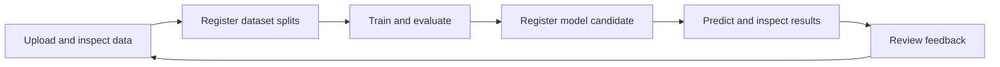

# BanglaGuard

BanglaGuard is a research workspace for **Bangla and Banglish hate speech detection and sentiment analysis**. It connects text prediction and model explanations to dataset preparation, reproducible training, error analysis, feedback, and model promotion.

The project helps researchers answer more than “what label did the model return?” It also shows which model ran, how close the class scores were, what text fragments supported the prediction, and where a candidate makes mistakes before it becomes the default.

[Features](#features) · [How it works](#how-it-works) · [Run locally](#run-locally) · [Developer guide](docs/DEVELOPER_GUIDE.md)

## Features

| Workspace | What you can do |
| --- | --- |
| **Prediction** | Analyse Bangla, Romanized Bangla (Banglish), or mixed text; select a task and compatible model; inspect class scores, supporting tokens, and review warnings. |
| **Datasets** | Import labeled CSV files or predefined splits, map text and labels, inspect class balance and duplicates, and register a reproducible dataset version. |
| **Experiments** | Train TF-IDF/logistic regression or BanglaBERT in the background. Track progress, review held-out scores, and inspect confusion matrices and individual errors. |
| **Model registry** | Register trained models as candidates, test them without changing the default, and review evidence before promotion or rollback. |
| **Research tools** | Compare model predictions, analyse CSV batches, and save regression cases. |
| **Feedback and administration** | Report wrong predictions, review and export corrected examples, and manage roles, platform policy, and audit records. |

Hate speech and sentiment are separate tasks. The trained model determines which labels are available: a binary hate speech model returns hate/non-hate, while a three-class model trained with an offensive label can distinguish it separately.

## How it works



| Layer | Technology and responsibility |
| --- | --- |
| Browser | Next.js, React, TypeScript, and Tailwind provide the prediction and research workspaces. |
| API | FastAPI validates requests and permissions, selects models, and coordinates dataset, training, and feedback operations. |
| Training and inference | scikit-learn handles classical baselines. PyTorch and Hugging Face Transformers handle BanglaBERT. A separate worker runs one training job at a time. |
| Persistence | PostgreSQL stores application records; Redis supports runtime services; a local SQLite queue tracks training jobs. The filesystem stores uploads, metrics, and model artifacts. |

See the [architecture diagram and repository map](docs/DEVELOPER_GUIDE.md#architecture), [training workflow](docs/DEVELOPER_GUIDE.md#research-workflow), and [prediction and feedback sequence](docs/DEVELOPER_GUIDE.md#prediction-and-feedback-flow).

## Run locally

Use **Python 3.14**, **Node.js 22 or 24 with npm** (Next.js requires at least 20.9), Git, and Docker Compose v2. On Windows, use **WSL 2** for the backend and training worker; follow the [Windows setup](docs/DEVELOPER_GUIDE.md#windows-wsl-2) before running these shell commands.

From the repository root:

```bash
cp .env.example .env
cp frontend/.env.example frontend/.env.local
python3.14 -m venv backend/.venv
source backend/.venv/bin/activate
python -m pip install -r requirements.txt
docker compose up -d --wait
```

Before starting the backend, replace the placeholder `SECRET_KEY` in `.env` with a local random secret. Run each server in its own terminal:

```bash
# Terminal 1 — start from the repository root
cd backend
source .venv/bin/activate
alembic upgrade head
python -m uvicorn app.main:app --host 127.0.0.1 --port 8000
```

```bash
# Terminal 2 — start from the repository root
cd frontend
npm ci
npm run dev -- --hostname 127.0.0.1 --port 3000
```

Open [the app](http://localhost:3000), [API documentation](http://localhost:8000/docs), or [service readiness](http://localhost:8000/api/v1/health/ready). A fresh installation starts with no trained model. Follow [First run](docs/DEVELOPER_GUIDE.md#first-run-account-and-model) to set up a local research account, train a baseline, and run a prediction.

Trained models and private research data stay outside Git. Predictions and attributions are research outputs; they can be wrong, including at high confidence.


## Documentation

- [Developer guide](docs/DEVELOPER_GUIDE.md) — Windows and macOS setup, first account and model, environment settings, API map, testing, and troubleshooting.
- [Experiment training](docs/experiment-training-workflow.md) and [evaluation and promotion](docs/evaluation-and-promotion.md) — readiness, job lifecycle, metrics, and model review.
- [Prediction research](docs/prediction-research-workspace.md) and [feedback workflow](docs/research-projects-and-feedback.md) — comparisons, regression cases, corrections, and curation.
