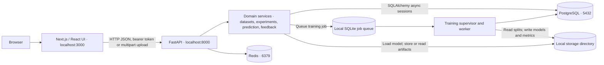
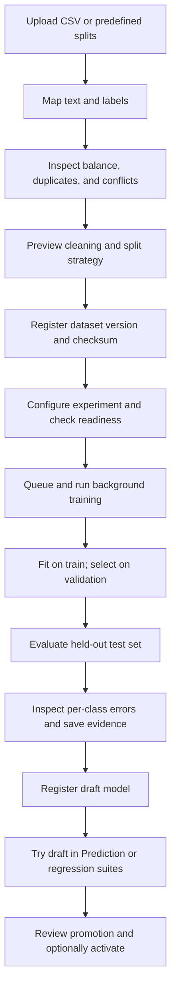
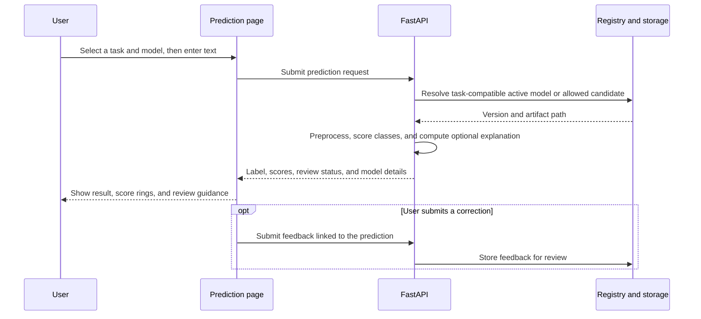

# BanglaGuard Developer Guide

This guide covers the local development environment and the full research workflow. It assumes access to the private GitHub repository and does not require the original developer's database or trained models.

## Contents

- [What the app does](#what-the-app-does)
- [Architecture](#architecture)
- [Repository map](#repository-map)
- [System requirements](#system-requirements)
- [Local setup](#local-setup)
- [First run: account and model](#first-run-account-and-model)
- [Research workflow](#research-workflow)
- [Prediction and feedback flow](#prediction-and-feedback-flow)
- [Configuration and storage](#configuration-and-storage)
- [API map](#api-map)
- [Testing and maintenance](#testing-and-maintenance)
- [Troubleshooting](#troubleshooting)
- [Deployment and research limits](#deployment-and-research-limits)

## What the app does

| Workspace | Purpose |
| --- | --- |
| Prediction | Analyse Bangla, Banglish, and mixed-script text for hate speech or sentiment; inspect class scores, supporting tokens, model details, and review warnings. |
| Prediction history and research tools | Reopen prior analyses, compare models, run CSV batches, and maintain regression suites. |
| Datasets | Inspect CSV columns and labels, check quality and overlap, preview cleaning, import existing train/validation/test splits, and register dataset versions. |
| Experiments | Configure classical TF-IDF or transformer classifiers, check readiness, submit background jobs, track progress, and explore saved metrics and errors. |
| Models | Register trained artifacts as candidates, compare versions, review promotion evidence, activate or roll back versions, and archive unused candidates. |
| Feedback and research projects | Collect corrections, review examples, prioritize uncertain cases, and export curated data for future training. |
| Administration and audit | Manage policy and account access and inspect recorded administrative actions. |

Hate speech and sentiment are separate backend tasks. Banglish shortcuts select models for the corresponding task; they do not introduce new backend task enums. The dataset and trained artifact determine available class labels. For example, a binary hate speech model cannot return an `offensive` class, while a three-class candidate can if it was trained with that label.

## Architecture



- **Frontend:** Next.js App Router, React, TypeScript, Tailwind, TanStack Query, and client state stores. Pages compose workspace components; shared API functions call the backend.
- **API:** FastAPI routes validate input and access, then call domain services. Pydantic defines request and response shapes. JWTs identify the signed-in user; the backend enforces roles and policy.
- **Persistence:** PostgreSQL stores application records. Redis supports runtime services and is checked by readiness. The training queue and model files are local to the backend host.
- **Training:** The API queues work and starts a detached supervisor when needed. One job runs at a time. Classical fitting uses scikit-learn; transformer fine-tuning uses PyTorch and Hugging Face Transformers. The worker can use CPU, Apple MPS, or CUDA when available and configured.
- **Inference:** The backend resolves an active or explicitly selected model for the requested task, preprocesses the text, runs the model, and returns the predicted label, scores, and available explanation data.

## Repository map

| Path | Responsibility |
| --- | --- |
| `frontend/app/` | Routes, layouts, protected workspaces, and authentication pages |
| `frontend/components/` | Prediction, datasets, experiments, models, feedback, and shared UI |
| `frontend/lib/`, `frontend/types/`, `frontend/store/` | API clients, frontend contracts, and client state |
| `backend/app/api/v1/` | HTTP endpoints and router registration |
| `backend/app/domain/services/` | Business logic, training orchestration, dataset preparation, evaluation, and promotion |
| `backend/app/db/`, `backend/alembic/` | SQLAlchemy models, repositories, sessions, and database migrations |
| `backend/app/ml/`, `backend/app/workers/` | Inference, preprocessing, explanations, and background training |
| `backend/tests/` | Backend tests for schemas, services, training, evaluation, and workflow behavior |
| `research/` | Offline research code and a small sample dataset |
| `storage/` | Runtime artifacts. Generated content is ignored by Git. |
| `docker-compose.yml` | Local PostgreSQL and Redis |
| `docker-compose.prod.yml`, `deployment/` | Deployment building blocks, separate from local setup |
| `requirements.txt`, `backend/requirements.txt` | Root installer entry point and pinned backend dependencies |
| `frontend/package-lock.json` | Reproducible frontend dependencies |

## System requirements

| Requirement | Notes |
| --- | --- |
| macOS or Windows with WSL 2 | Run Python on macOS or inside Linux on Windows. The background worker uses Unix file locks and process signals, so native Windows Python is not a supported full-training setup. |
| Python 3.14 | Matches the existing backend environment and Docker image. Install the interpreter and its virtual environment support. |
| Node.js and npm | Use Node.js 22 or 24. [Next.js 16's minimum is 20.9](https://nextjs.org/docs/app/getting-started/installation). |
| Git | Required for the private clone and the commit-pinned Bangla normalizer dependency. |
| Docker Desktop / Docker Compose v2 | Runs PostgreSQL 17 and Redis 7 for local development. |
| Network and disk | The first install downloads packages and container images. Transformer experiments may download a pretrained checkpoint and store multiple copies of weights. Start with the classical baseline on a low-memory machine. |

### macOS

Install Python 3.14, Node.js, Git, and [Docker Desktop](https://docs.docker.com/desktop/setup/install/mac-install/) for your Mac architecture. Start Docker Desktop. On Apple Silicon, use native ARM64 tools consistently; mixed Intel and ARM64 environments can cause wheel and dynamic library failures. If no GPU is available, select CPU for training.

### Windows (WSL 2)

1. In an elevated PowerShell terminal, install WSL and Ubuntu (see [Microsoft's WSL installation guide](https://learn.microsoft.com/en-us/windows/wsl/install)):

   ```powershell
   wsl --install -d Ubuntu
   wsl --list --verbose
   ```

   Restart if prompted. Confirm Ubuntu is listed as version 2.

2. Start Docker Desktop for Windows with its WSL 2 engine. Enable Ubuntu in **Settings → Resources → WSL Integration**. See [Docker's WSL integration instructions](https://docs.docker.com/desktop/features/wsl/).
3. Open the **Ubuntu terminal**. Install Linux Git, Python 3.14 with venv support, and a Linux Node.js 22 or 24 distribution. If your Ubuntu release does not package Python 3.14, use an interpreter manager or an Ubuntu release that does; verify `python3.14 --version` before continuing. Avoid invoking Windows `python.exe` or `node.exe` inside WSL for this setup.
4. Clone into the Linux filesystem, for example `~/projects/BanglaGuard`, instead of `/mnt/c`. Run the rest of this guide in Ubuntu. Use the Windows browser to open the app at `localhost:3000`. Use CPU unless GPU support has already been configured in WSL.

## Local setup

### 1. Clone and verify tools

Request repository access from the owner first. Authenticate Git via GitHub CLI, a Git credential manager, or SSH. With HTTPS:

```bash
git clone https://github.com/fahimroy22/BanglaGuard.git
cd BanglaGuard
python3.14 --version
node --version
npm --version
git --version
docker compose version
```

### 2. Configure local environment files

Run these once on a fresh clone. Keep existing environment files if you are updating a working setup.

```bash
cp .env.example .env
cp frontend/.env.example frontend/.env.local
python3.14 -c 'import secrets; print(secrets.token_hex(32))'
```

Set `SECRET_KEY` in the root `.env` to the generated value. Keep the local PostgreSQL credentials consistent across `POSTGRES_*` and `DATABASE_URL`. The sample values are for local development. The browser needs `NEXT_PUBLIC_API_BASE_URL=http://localhost:8000/api/v1` in `frontend/.env.local`. Variables prefixed with `NEXT_PUBLIC_` are public to the frontend.

### 3. Install and start dependencies

From the root:

```bash
python3.14 -m venv backend/.venv
source backend/.venv/bin/activate
python -m pip install --upgrade pip
python -m pip install -r requirements.txt
python -m pip check
docker compose up -d --wait
docker compose ps
```

The root requirements file delegates to the same backend pins used by the Docker image. If a dependency has no wheel for your OS and architecture, use a supported Python 3.14 environment; avoid unpinning the entire ML stack to work around a single failed package. Existing saved models can depend on compatible versions.

### 4. Start the API

In the first terminal, from the root:

```bash
cd backend
source .venv/bin/activate
alembic upgrade head
alembic current
python -m uvicorn app.main:app --host 127.0.0.1 --port 8000
```

Add `--reload` for active backend development. The training supervisor is started by the API; it does not need its own terminal.

### 5. Start the frontend

In a second terminal, from the root:

```bash
cd frontend
npm ci
npm run dev -- --hostname 127.0.0.1 --port 3000
```

### 6. Verify services

```bash
curl -fsS http://localhost:8000/api/v1/health/live
curl -fsS http://localhost:8000/api/v1/health/ready
```

Open [BanglaGuard](http://localhost:3000), [Swagger UI](http://localhost:8000/docs), or [OpenAPI JSON](http://localhost:8000/openapi.json). Readiness should report both PostgreSQL and Redis as connected. The live route only confirms that the API process is up.

## First run: account and model

1. Use **Create account** on the local site. Self-registration creates a regular user. Research and admin actions require the appropriate role.
2. For an **owned, disposable local development database**, the database owner can bootstrap the first admin after registering their account. From the repository root, open PostgreSQL using the sample credentials:

   ```bash
   docker compose exec postgres psql -U banglaguard -d banglaguard
   ```

   In `psql`, replace the example email with your registered local account:

   ```sql
   SELECT email, role FROM users WHERE email = 'you@example.com';
   UPDATE users SET role = 'ADMIN' WHERE email = 'you@example.com' RETURNING email, role;
   ```

   Type `\q` to exit. Verify exactly one row was updated, then sign out and back in. On shared systems, use your administrator's account provisioning process instead.
3. In **Datasets**, upload labeled data that you have permission to use. Use `text,label` CSV columns or map your own headers. Ensure each label is represented in the required splits. The repository's small `research/data/sample_hate_speech.csv` is for trying the import flow; readiness may reject it for training, and its metrics are not meaningful.
4. In **Experiments → New experiment**, select the dataset and start with the **Classical baseline**. Check readiness, prepare the experiment, and start background training.
5. When the run completes, open its evaluation and **Register model**. While signed in with research/admin permissions, choose the draft from **Prediction → Change model** and try a sentence. For regular users, the app requires an active model for the selected task. Review and promote it through the Models workflow when appropriate.

## Research workflow



- Deduplicate and keep related comments together **before** assigning splits. When importing published benchmark splits, preserve membership and investigate overlap rather than silently reshuffling it.
- Record label definitions, sources, licenses, collection limits, preprocessing choices, and split provenance. Review ambiguity and inconsistent labels before treating them as ground truth.
- Use validation for model and threshold selection. Do not repeatedly tune on the test set. Compare models on the **same** dataset version and split; report macro F1 and per-class precision, recall, and confusion counts.
- The worker tracks progress and stores configuration, provenance, metrics, and artifacts. Readiness checks data integrity, class balance, compute, and checkpoint availability. Transformer runtime may exceed classical training substantially.
- Cancellation, retry, and resume are managed from the job UI. Resume depends on a complete compatible checkpoint. See [training workflow](experiment-training-workflow.md) and [evaluation and promotion](evaluation-and-promotion.md).

## Prediction and feedback flow



Use **Banglish hate speech** or **Banglish sentiment** when the corresponding model is available. The script detector is heuristic: Latin script can be Banglish or English. A model's highest score is not the probability that it is correct. Word contributions may refer to token fragments and should not be interpreted as proof of meaning. Feedback does not retrain a model immediately: review and curate it before exporting examples for another experiment.

See [Prediction research tools](prediction-research-workspace.md) and [Research projects and feedback](research-projects-and-feedback.md) for detailed flows.

## Configuration and storage

| Setting | Where | Purpose |
| --- | --- | --- |
| `SECRET_KEY` | Root `.env` | JWT signing secret. Generate separately for each environment. |
| `DATABASE_URL` | Root `.env` | Async PostgreSQL connection; Alembic converts it to the sync psycopg driver. |
| `POSTGRES_USER`, `POSTGRES_PASSWORD`, `POSTGRES_DB` | Root `.env` | Local PostgreSQL container initialization. Editing credentials does not reset an existing data volume. |
| `REDIS_URL` | Root `.env` | Redis connection, normally `redis://localhost:6379/0` locally. |
| `FRONTEND_URL`, `CORS_ORIGINS` | Root `.env` | Frontend origin and allowed browser origins. Set explicit origins if changing the host or port. |
| `NEXT_PUBLIC_API_BASE_URL` | `frontend/.env.local` | URL the browser uses for API requests. Restart Next.js after changing it. |
| `STORE_PREDICTION_TEXT` | Root `.env` | Default prediction-text storage setting; also review platform policy before using sensitive text. |
| `MODEL_STORAGE_PATH`, `EXPERIMENT_STORAGE_PATH`, `UPLOAD_STORAGE_PATH`, `REPORT_STORAGE_PATH` | Root `.env` | Runtime filesystem locations. Preserve access for the backend and training worker. |

PostgreSQL holds account, dataset, experiment, model, prediction, feedback, and audit records. Files under `storage/` hold uploaded datasets, training artifacts, checkpoints, job queue data, logs, and exports. **Back up PostgreSQL and the corresponding storage together** if you need to restore a working experiment or registry. Cloning the repository alone does not restore any private datasets, accounts, or models. Do not commit secrets, model weights, generated exports, database dumps, or uploaded text.

## API map

Use the running [OpenAPI schema](http://localhost:8000/openapi.json) for exact paths, methods, parameters, and response codes. The [checked-in snapshot](api/openapi.json) is reference material and may lag the running code.

| Router family under `/api/v1` | Purpose |
| --- | --- |
| Health, auth, users, admin | Liveness/readiness, registration, session, accounts, and platform policy |
| Datasets and dataset research | Upload, inspect, clean, split, register, and inspect quality |
| Experiments and experiment research/jobs | Prepare configurations, launch runs, and monitor or manage jobs |
| Evaluation, model versions, model promotion | Metrics and errors, artifact registry, activation, promotion, and rollback |
| Predictions and prediction research | Single prediction, history, model comparison, CSV batch, and regression workflows |
| Feedback, research loop, analytics, audit logs | Corrections, curation, aggregate results, and audit records |

## Testing and maintenance

From `backend/`, using the virtual environment:

```bash
python -m pip check
alembic heads
python -m pytest -q
```

From `frontend/`:

```bash
npm ci
npx tsc --noEmit
npm run lint
npm run build
```

Before a release, run a local smoke test: verify both health routes, sign in, register a dataset version, train or select a model, run a prediction, and open class scores and feedback. For training changes, also check held-out metrics and failure/retry behavior. Update dependency pins deliberately, rerun tests and the prediction smoke test, and update setup instructions if a runtime version changes.

Stop the frontend and backend with **Ctrl+C** in their respective terminals. From the repository root, `docker compose stop` stops the database and Redis while retaining their volumes. Stop or cancel active jobs from the experiment UI before maintenance. Do not use `docker compose down -v` unless you intend to delete the local database volumes.

## Troubleshooting

| Symptom | Check or fix |
| --- | --- |
| Cannot clone the repository | Verify GitHub access and authenticate using your own account. |
| Docker daemon unavailable | Start Docker Desktop; in WSL verify distro integration and Linux container mode. |
| Port already in use | Check `docker compose ps` and existing dev servers. If you change a port, update the associated URL, host binding, and allowed origins. |
| API reports database not ready | Confirm PostgreSQL is healthy, credentials match the initialized volume, and migrations ran against that database. |
| API reports Redis not ready | Verify the Redis container, its published port, and `REDIS_URL`. |
| Browser cannot reach API | Check the API URL in `frontend/.env.local`, API health, and CORS; restart Next.js after editing environment settings. |
| Cannot see training controls | Sign in with a permitted researcher/admin account and check platform policy. |
| No active or compatible model | Select the correct task and a permitted candidate, or train and register a model on a fresh installation. |
| Dataset readiness fails | Check label coverage and class balance, split files, integrity, and conflicts. Address the data issue before training. |
| Transformer remains in Preparing | Check the job log and network access for pretrained weights. Verify checkpoint path, disk, memory, and runtime device. |
| Worker fails with `fcntl` on Windows | Run the backend inside WSL 2, not with Windows Python. |
| Model files cannot be loaded after a clone | Restore the corresponding trusted artifacts and database records, or train new versions. Only load model files from trusted sources. |

## Deployment and research limits

Local setup is designed for development on your own machine. The production Compose file, backend Dockerfile, and Nginx configuration are deployment starting points. Review secrets, database access, public frontend hosting, HTTPS, backups, and filesystem permissions before using them for an exposed service. GitHub stores source; pushing to GitHub does not deploy the app.

The queue and artifact storage currently assume a single training host. Model scores depend on language form, source domain, labels, and data quality. Validate with representative, independently labeled Bangla and Banglish samples before operational use. Keep human review for uncertain or consequential decisions.

Further reading: [Project scope](PROJECT_SCOPE.md) · [Training workflow](experiment-training-workflow.md) · [Evaluation and promotion](evaluation-and-promotion.md) · [Prediction research workspace](prediction-research-workspace.md) · [Research projects and feedback](research-projects-and-feedback.md).
